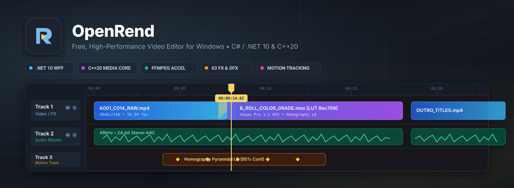
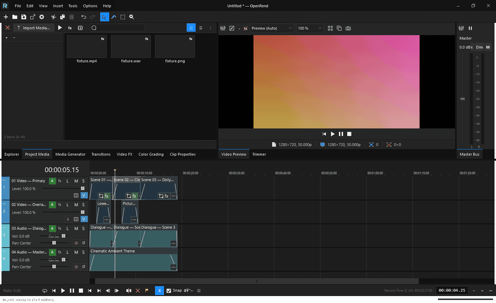
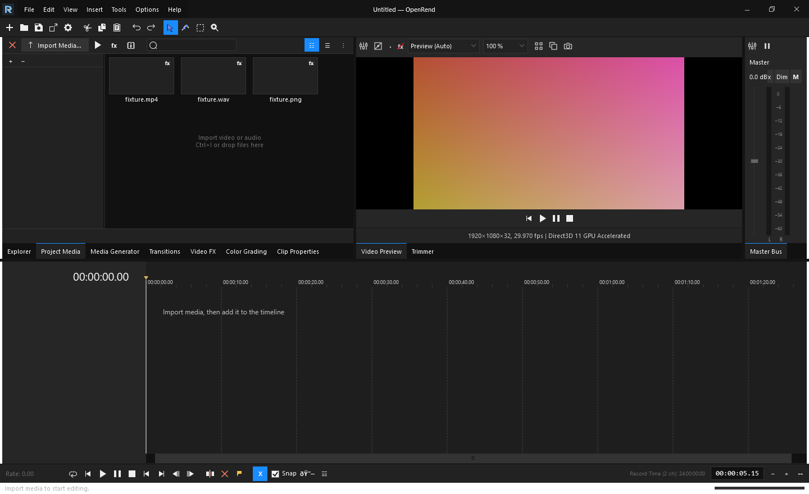
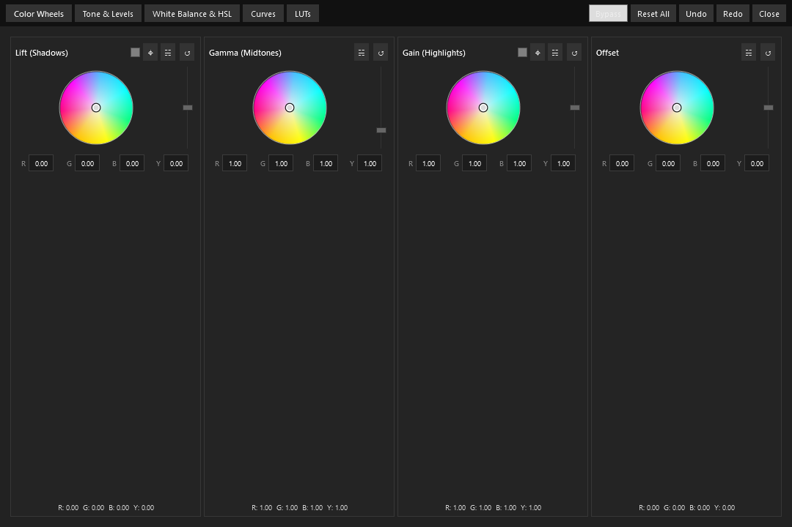
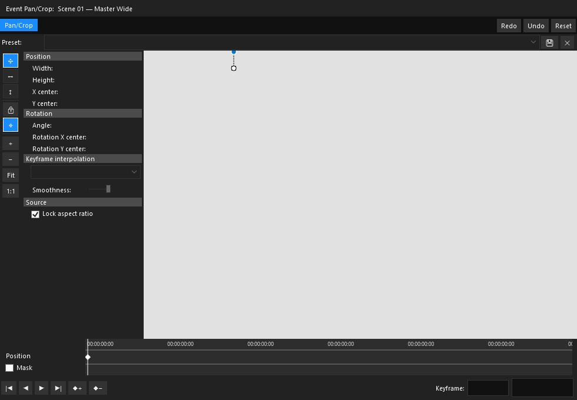
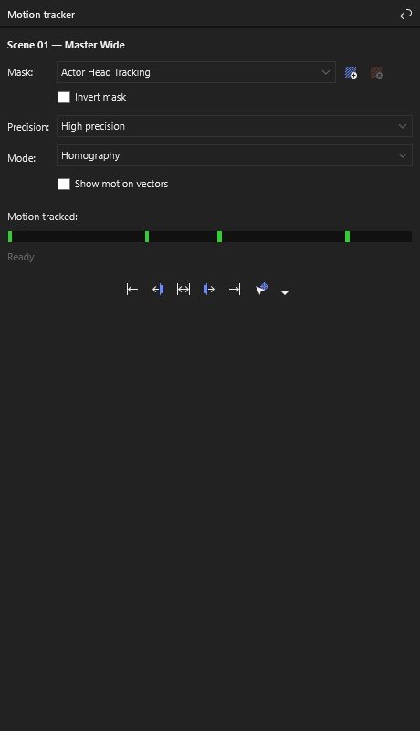
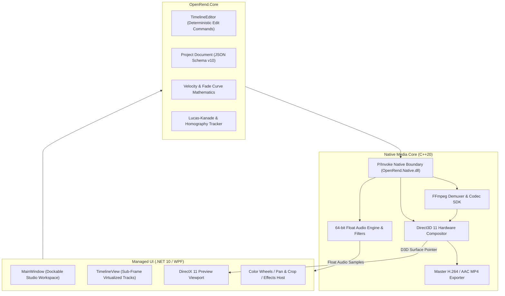

<p align="center">
  
</p>

<p align="center">
  <strong>Fast, deterministic, open-source Windows non-linear video editor built with C# / .NET 10, WPF, and a native C++20 / Direct3D 11 media engine.</strong>
</p>

<p align="center">
  <a href="https://github.com/jamiejustcodes/OpenRend/actions/workflows/build.yml"></a>
  <a href="https://github.com/jamiejustcodes/OpenRend/releases/latest"></a>
  
  
  
  
  <a href="LICENSE"></a>
</p>

<p align="center">
  <a href="#-overview">Overview</a> •
  <a href="#-screenshots">Screenshots</a> •
  <a href="#-core-capabilities">Capabilities</a> •
  <a href="#-quick-start--build">Quick Start</a> •
  <a href="#-keyboard-shortcuts">Shortcuts</a> •
  <a href="#-engine-architecture">Architecture</a> •
  <a href="#-contributing">Contributing</a>
</p>

---

## 🎬 Overview

**OpenRend** is an open-source non-linear video editor designed for high-throughput Windows desktop workflows. It pairs a managed **WPF / .NET 10** studio interface with a native **C++20** media engine accelerated by **Direct3D 11** and the **FFmpeg SDK**.

Unlike traditional editors that approximate preview quality or decouple the playback engine from final encoding, OpenRend evaluates timeline composition deterministically using rational arithmetic. What scrubs in the viewport matches final master exports frame-for-frame across colorspaces, velocity curves, and transition geometries.

<p align="center">
  
</p>
<p align="center">
  <em>Live timeline scrubbing across automatic crossfades, multi-track audio waveforms, and GPU preview in OpenRend (<a href="assets/demo.mp4">Download MP4 video</a>).</em>
</p>

---

## 📸 Screenshots

| Studio Workspace & Multi-Track Timeline | 3-Way Color Grading Suite |
| :---: | :---: |
| [](assets/screenshots/workspace.png) | [](assets/screenshots/color_grading.png) |
| *Docked project media, 1080p preview, master audio bus dB meter, and multi-track timeline.* | *Interactive Lift, Gamma, Gain, and Offset color wheels with tone and level adjustments.* |

| Video Event Pan / Crop & Keyframing | Pyramidal Lucas-Kanade Motion Tracking |
| :---: | :---: |
| [](assets/screenshots/pan_crop.png) | [](assets/screenshots/motion_tracking.png) |
| *Aspect ratio framing, keyframe interpolation curves, and Bézier masking tool.* | *Optical flow feature tracking, homography planar solver, and confidence scoring.* |

---

## ✨ Core Capabilities

### 🎞️ Precision Non-Destructive Timeline
- **Multi-Track Compositing**: Unlimited video and audio tracks with per-track opacity, gain, pan, mute, solo, and composite modes (Source Alpha, Add, Multiply, Screen).
- **Vegas Pro 1:1 Editing Workflow**: High-speed split (`S`), automatic crossfades, magnetic ripple editing (`Auto-Ripple`), and grouped clip pairs (`G` / `U`).
- **Velocity & Fade Envelopes**: Clip velocity envelopes (-100% to +300%) and 5×5 reciprocal fade curves evaluated with integer project frame precision.
- **Sub-Frame Audio Alignment**: Multi-track audio editing with sample-accurate cuts and zero-crossing transitions.

### 🎨 Color Grading & Studio Scopes
- **3-Way Color Wheels**: Interactive Lift, Gamma, Gain, and Offset controls with numerical readout and real-time GPU preview.
- **Hardware Scopes**: Real-time RGB Parade, Waveform Monitor, and Vectorscope for broadcast compliance and color balancing.
- **3D LUT Integration**: Direct import and evaluation of `.cube` 3D lookup tables with intensity and interpolation controls.

### 🎛️ Comprehensive Effects & Transitions
- **63 Built-In Video Effects**: Color balance, separable Gaussian blur, levels, unsharp mask, chroma keying, glow, and stylize filters.
- **18 OFX Video Transitions**: Full transitions catalog including Linear Wipe, Clock Wipe, Barn Door, Push, Slide, Zoom, Page Peel, and Crossfade.
- **Audio DSP Chain**: Built-in 4-band parametric Track EQ, Track Compressor, and Track Noise Gate with real-time dB peak/RMS metering.

### 🎯 Planar & Motion Tracking
- **Pyramidal Optical Flow**: Multi-scale Lucas-Kanade feature tracking with confidence scoring.
- **Affine & Homography Solvers**: 6-parameter affine stabilization and Direct Linear Transform (DLT) 4-point planar tracking.

### ⚡ Performance & Reliability
- **Direct3D 11 GPU Compositing**: Zero-copy surface presentation directly into WPF via DirectX swapchain interop.
- **Multithreaded Asynchronous Decode**: Background frame pre-fetching, audio ring buffering, and asynchronous thumbnail generation.
- **Real-Time Debounced Crash Recovery**: Timeline edits automatically persist recovery snapshots within 3 seconds of settling. Normal sessions exit cleanly with zero orphaned temp files.
- **Zero-Codec Portable Bundle**: Self-contained x64 deployment without system-wide codec installations or registry modifications.

---

## 🚀 Download & Installation

Pre-compiled, self-contained standalone bundles are available under **[Releases](https://github.com/jamiejustcodes/OpenRend/releases/latest)**.

1. Download **`OpenRend-win-x64.zip`**.
2. Extract the archive to any directory.
3. Run **`OpenRend.exe`**.

> **Supported Operating Systems**: 64-bit Windows 10 (version 1903+) and Windows 11.

---

## 🛠️ Quick Start & Build

### Prerequisites
- 64-bit Windows 10 or 11
- **.NET 10 SDK** (v10.0.303 or newer, configured via `global.json`)
- **Visual Studio 2022 / 2026** with *Desktop development with C++*, *MSVC v143/v144 tools*, and *Windows 10/11 SDK*
- **Git**

### Clone & Build
```powershell
# Clone the repository
git clone https://github.com/jamiejustcodes/OpenRend.git
cd OpenRend

# Execute unified build script (configures CMake, builds C++20 engine, compiles WPF app, runs test suite)
.\tools\build.ps1

# Run the compiled executable
.\src\OpenRend.App\bin\Release\net10.0-windows\win-x64\OpenRend.exe
```

### Build Options
```powershell
# Fast build: skip native compilation when editing managed WPF UI
.\tools\build.ps1 -SkipNative

# Quick build: compile without running tests
.\tools\build.ps1 -SkipTests

# Package a self-contained portable distribution in .\dist\OpenRend
.\tools\build.ps1 -Package
```

---

## ⌨️ Essential Keyboard Shortcuts

| Shortcut | Context | Action |
|---|---|---|
| `Space` | Playback | Play / Pause |
| `Enter` | Playback | Pause at cursor |
| `Escape` | Workspace | Stop playback / Cancel active edit drag |
| `Alt` + `Left` / `Right` | Timeline | Step one frame backward / forward |
| `Ctrl` + `Home` / `End` | Timeline | Seek to project start / end bounds |
| `Ctrl` + `Mouse Wheel` | Timeline | Zoom timeline in / out |
| `Shift` + `Mouse Wheel` | Timeline | Scroll timeline horizontally |
| `S` | Editing | **Split** selected clips at playhead |
| `Delete` | Editing | Delete selected clips |
| `Ctrl` + `Shift` + `Delete` | Editing | Ripple delete time selection |
| `G` / `U` | Clips | **Group** / **Ungroup** selected clips |
| `M` / `Shift` + `M` | Tracks | Toggle track Mute / Solo |
| `Ctrl` + `I` | Media | Import media files |
| `Ctrl` + `Shift` + `E` | Export | Open **Render As** dialog |
| `Ctrl` + `S` | Project | Save project document |

---

## 🏗️ Engine Architecture



---

## 🤝 Contributing

Contributions are welcome. Please read our **[Contributing Guidelines](CONTRIBUTING.md)** and review the **[Security Policy](SECURITY.md)** before opening a pull request.

- Check open issues or start a discussion for larger feature proposals.
- Ensure all native and managed test suites pass (`.\tools\build.ps1`).
- Stage explicit file paths and use descriptive, atomic commit messages.

---

## 📄 License & Third-Party Notices

- OpenRend is licensed under the **[GNU General Public License v3.0 (GPL-3.0-or-later)](LICENSE)**.
- Third-party libraries (including FFmpeg, GoogleTest, and community icons) retain their respective open-source licenses. Detailed notices and attributions are available in **[THIRD-PARTY-NOTICES.md](THIRD-PARTY-NOTICES.md)**.
