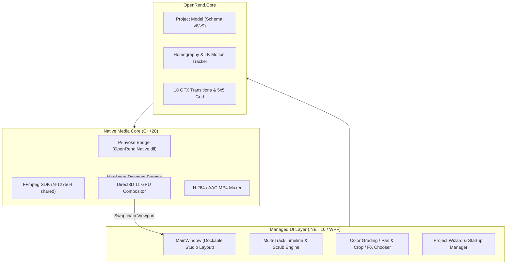

<p align="center">
  
</p>

<p align="center">
  <strong>Free, open-source Windows video editor built with C# / .NET 10, WPF, and a high-performance C++20 media engine.</strong>
</p>

<p align="center">
  <a href="https://github.com/jamiejustcodes/OpenRend/releases/latest"></a>
  <a href="https://github.com/jamiejustcodes/OpenRend/actions/workflows/build.yml"></a>
  <a href="LICENSE"></a>
  
  
  
</p>

<p align="center">
  <a href="https://github.com/jamiejustcodes/OpenRend/releases/latest"><b>🚀 Download Portable Bundle (v0.1.0)</b></a> •
  <a href="#-key-features"><b>Features</b></a> •
  <a href="#-quick-start--build"><b>Build from Source</b></a> •
  <a href="#-keyboard-shortcuts"><b>Shortcuts</b></a> •
  <a href="#-architecture"><b>Architecture</b></a> •
  <a href="#-documentation"><b>Docs</b></a>
</p>

---

## 🎬 Overview

**OpenRend** is a non-linear video editing suite designed for responsiveness, deterministic rendering, and modern Windows workflows. It pairs a managed **WPF / .NET 10** timeline with a native **C++20** decoding and composition pipeline accelerated by the **FFmpeg SDK**.

Preview and final export share the exact same edit decisions, rational time evaluation, and mathematical color pipeline — what you scrub in the preview monitor is frame-for-frame what renders into your master export.

---

## ✨ Key Features

| Capability | Details |
|---|---|
| 🎞️ **Multi-Track Non-Destructive Timeline** | Non-destructive video & audio editing, magnetic ripple trimming, group linking (`G`/`U`), and sub-frame precision. |
| ⚡ **Hybrid C++20 & .NET 10 Engine** | Native FFmpeg decoding with DirectX 11 / D3D preview composition and smooth UI dispatch. |
| 🎨 **1:1 Vegas Pro Color Grading & Scopes** | Interactive color grading wheels (Lift / Gamma / Gain / Offset), multi-scope analysis (Parade, Waveform, Vectorscope), and embedded 3D `.cube` LUT filters. |
| 🔄 **18 OFX Video Transitions & Curves** | 18 transition plugins (Dissolve, Wipes, Spatial Reveals, Transforms) alongside a **5×5 reciprocal fade curve** matrix. |
| 🎯 **Pyramidal Motion & Mask Tracking** | Lucas-Kanade optical flow, 6-parameter affine decomposition, and DLT homography tracking. |
| 🎛️ **63 Built-in Video Effects** | Color grading, separable Gaussian blur, levels, stylize, glow, distortion, and composite filters. |
| 📦 **Zero-Config Portable Distribution** | Fully self-contained Windows x64 zip bundle — no installer, no system-wide codec installations required. |

---

## 🚀 Download & Run

No installer or administrative privileges required. 

1. Download **`OpenRend-win-x64.zip`** from the [Latest Release](https://github.com/jamiejustcodes/OpenRend/releases/latest).
2. Extract the archive anywhere on your machine.
3. Launch **`OpenRend.exe`**.

> Requirements: 64-bit Windows 10 or 11.

---

## 🛠️ Quick Start & Build

### Prerequisites
- Windows 10 / 11 x64
- **.NET 10 SDK** (v10.0.303+)
- **Visual Studio** with *Desktop development with C++*, *Windows 10/11 SDK*, and *CMake*
- **Git**

### 1. Build and Run Directly
```powershell
# Restore dependencies and build managed and native binaries
.\tools\build.ps1

# Launch OpenRend
.\src\OpenRend.App\bin\Release\net10.0-windows\win-x64\OpenRend.exe
```

### 2. Package a Standalone Release Bundle
```powershell
# Compiles binaries, stages FFmpeg libraries, and generates self-contained dist folder
.\tools\build.ps1 -Package

# Run packaged executable
.\dist\OpenRend\OpenRend.exe
```

---

## ⌨️ Keyboard Shortcuts

| Shortcut | Context | Action |
|---|---|---|
| `Space` | Playback | Play / Pause |
| `Enter` | Playback | Pause at current cursor |
| `Escape` | Playback / Editing | Stop playback / Cancel active drag |
| `Alt` + `Left` / `Right` | Timeline | Step one frame backward / forward |
| `Ctrl` + `Home` / `End` | Timeline | Jump to timeline start / end bounds |
| `Ctrl` + `Mouse Wheel` | Timeline | Zoom timeline in / out |
| `Shift` + `Mouse Wheel` | Timeline | Scroll timeline horizontally |
| `S` | Editing | **Split** selected clips at playhead |
| `Delete` | Editing | Remove selected clips (with optional ripple) |
| `G` / `U` | Editing | **Group** / **Ungroup** selected clips |
| `Ctrl` + `Shift` + `M` | Audio | Toggle audio mute leaving video visible |
| `M` / `Shift` + `M` | Tracks | Toggle track Mute / Solo |
| `Ctrl` + `I` | Media | Import video/audio media files |
| `Ctrl` + `Shift` + `E` | Export | Open **Render As** export dialog |
| `Ctrl` + `S` | Project | Save project (auto-saved recovery every 30s) |

---

## 🏗️ Architecture



---

## 📖 In-Depth Editing Guide

<details>
<summary><b>Media Import & Clip Arrangement</b></summary>

- **Import Media**: Press `Ctrl+I` or drag and drop audio/video files directly into the window. Double-click a source in Project Media to place it at the playhead cursor, or drag directly onto any track.
- **Linked Pairs**: Video with audio automatically links into paired picture/sound clips. `G` links any arbitrary selection; `U` unlinks; `Edit → Ignore clip groups` temporarily isolates individual items.
- **Trimming & Snapping**: Hover near clip edges to reveal high-precision trim handles. Snapping dynamically aligns dragged boundaries with adjacent clips, markers, and the playhead.
</details>

<details>
<summary><b>Pan/Crop, Keyframing & 63 Built-in Effects</b></summary>

- **Event Pan/Crop**: Select any clip and choose `Tools → Video event Pan/Crop`. Adjust source-pixel width, center, pivot, and rotation with aspect lock.
- **Keyframe Curves**: Pan/Crop keyframes support whole project frames with *Linear*, *Hold*, *Slow*, *Fast*, *Smooth*, and *Sharp* interpolation curves.
- **FX Catalog**: 63 built-in effects spanning color grading, blur, detail, keying, stylize, and glow. Supports 3D `.cube` LUT filters with intensity and interpolation controls.
</details>

<details>
<summary><b>18 Transitions & 5×5 Reciprocal Fade Grid</b></summary>

- **Transitions Tab**: Full catalog of 18 OFX video transitions (Linear Wipe, Clock Wipe, Barn Door, Push, Slide, Zoom, Page Peel, Dissolve).
- **Reciprocal Fades**: Right-click any video event to select incoming/outgoing curves or open the **5×5 Fade Type thumbnail grid** to set reciprocal crossfade pairs without altering clip positions.
</details>

<details>
<summary><b>Render & Export</b></summary>

- Press `Ctrl+Shift+E` to open the **Render As** dialog.
- Select from optimized H.264 / AAC presets matching project resolution and frame rate.
- Set in/out loop regions (`I`/`O`) to render isolated timeline sections.
- Preview and final export execute the exact same mathematical composition path.
</details>

---

## 📄 License & Notices

OpenRend is licensed under the [GNU General Public License v3.0 (GPL-3.0-or-later)](LICENSE).  
Third-party libraries (including FFmpeg and GoogleTest) retain their respective licenses. See [THIRD-PARTY-NOTICES.md](THIRD-PARTY-NOTICES.md) for full compliance details.
